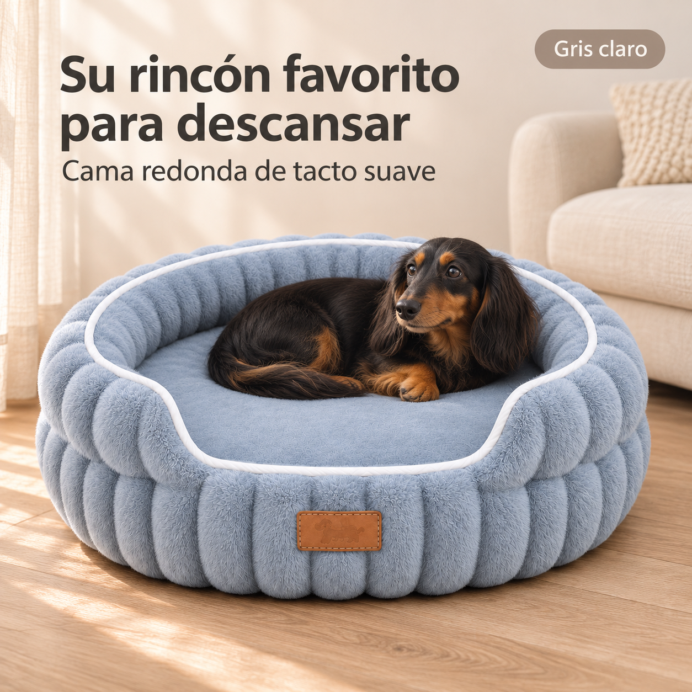
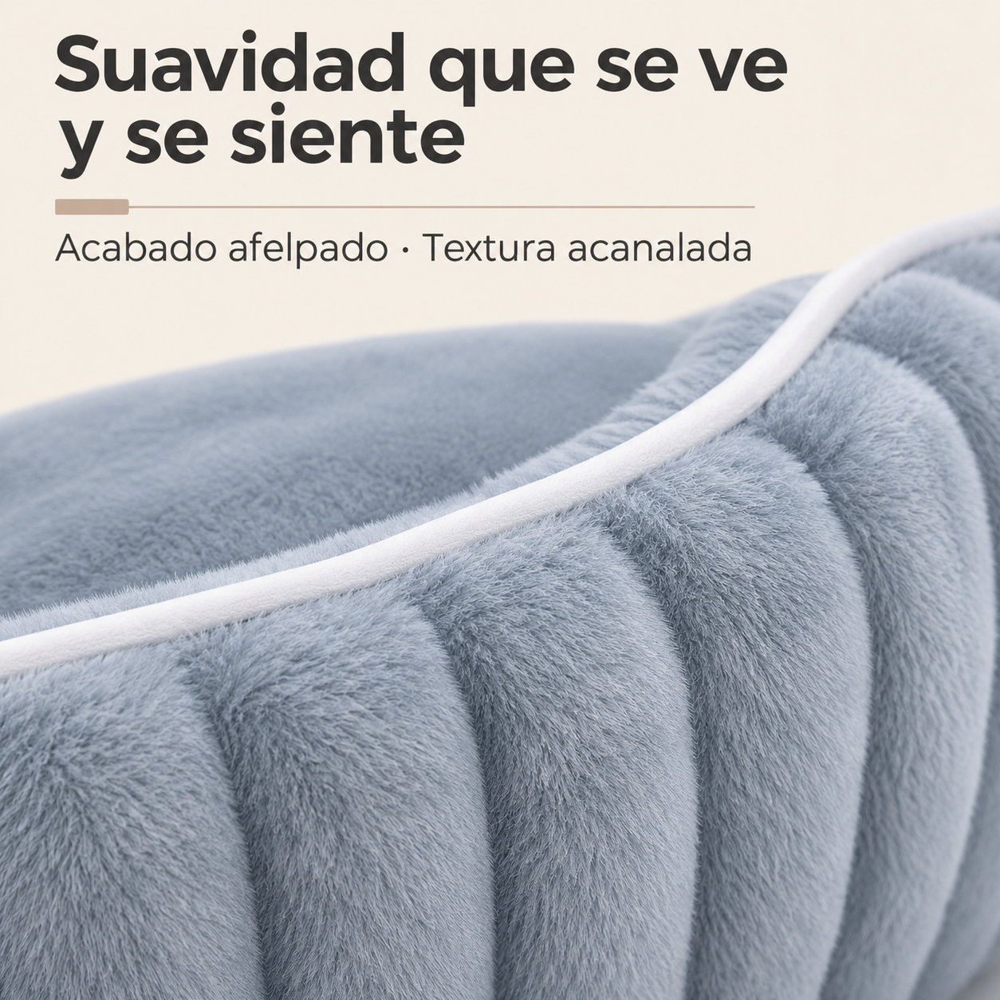
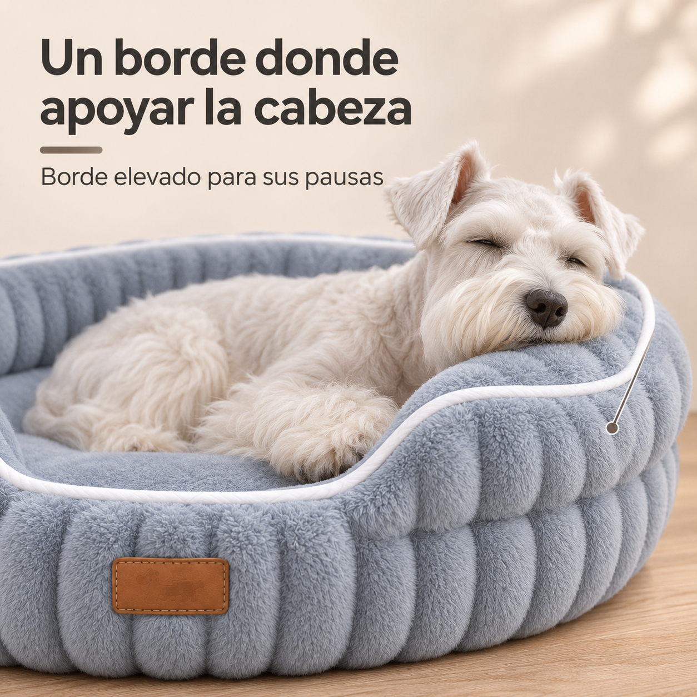
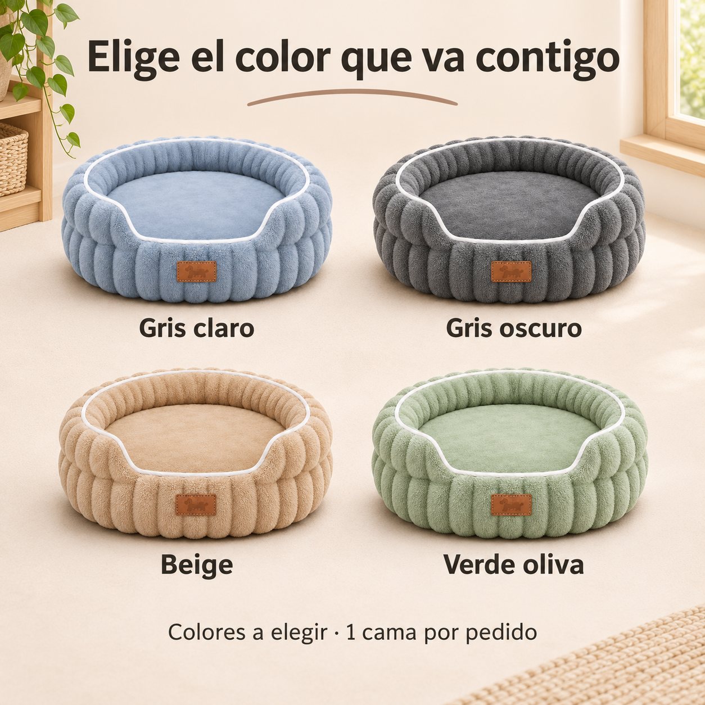
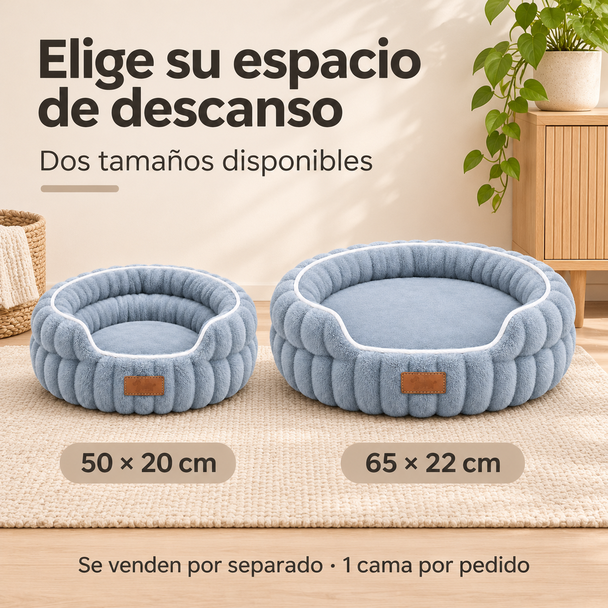

# Temu ES Visual Production

**面向 Temu 西班牙站的电商商品图 Skill：先问清商品与售卖方式，再研究、策划，最后直接出图。**

适用于宠物用品、家居等商品。默认制作 **1 张主图 + 6 张独立详情图，全部 1:1，图内使用西班牙西语（es-ES）**。图片数量、比例、语言和交付模式均可调整。

[使用教程](docs/usage.md) · [完整图文案例](examples/single-sale-pet-bed/README.md) · [Skill 入口](SKILL.md) · [填写模板](references/product-intake.md) · [方法来源](CREDITS.md)

## 能做什么

- **商品外观一致**：记录轮廓、开口、织纹、包边、小标、颜色与件数，根据任务选择原图编辑、合成或参考图生成。
- **卖点有画面证据**：将特点转成用户利益，用局部、动作、场景或参数解释，避免整套只给同一商品换标题。
- **适配西班牙买家**：研究可访问的西班牙同类页面，编写自然简短的 es-ES 文案，不照搬竞品功能。
- **售卖方式准确**：支持供货套装拆分单卖，分别记录颜色、尺寸选项与实际到手数量。
- **交付独立图片**：按需先提取单品参考，再生成主图与独立详情，附方案、提示词、总览和 ZIP。

## 安装

### 让 Codex 安装

把下面这句话发给支持安装 Skill 的 Codex：

~~~text
帮我安装这个 Skill：https://github.com/rayonfan/temu-es-visual-production
~~~

### 手动安装

macOS/Linux 终端需要 Git，默认安装到 ~/.codex/skills：

~~~bash
mkdir -p ~/.codex/skills
git clone https://github.com/rayonfan/temu-es-visual-production.git ~/.codex/skills/temu-es-visual-production
~~~

若已自定义 CODEX_HOME，请将目标改为该目录下的 skills/temu-es-visual-production。已有同名目录时先保留现有副本，不直接覆盖。安装后在下一轮消息调用。

## 快速开始

~~~text
$temu-es-visual-production
~~~

Skill 先询问本次商品和图片，并提供模板与示例。附图并回复产品名称、售卖方式、实际到手数量、已知规格即可；未知写“不确定”，受众、卖点、风格可留空。

**商品事实与图片分工 → 西班牙竞品研究 → 西语文案与逐图方案 → 独立生图 → 验收与图片包。**

默认输出方案后直接制作。若要先审稿，请写“先只给方案，等我确认后再生图”。首次调用已带完整资料并明确出图时直接进入制作。

## 实际案例：两件供货，拆分单卖

浅灰色圆形抽条绒宠物窝的供货图将两个尺寸叠放，实际拆成两个尺寸 SKU，每单只收到 1 个。

| 项目 | 实际处理 |
|---|---|
| 单品参考 | 两个尺寸分别生成，不叠放、不补造第三尺寸 |
| 主图 | 单个浅灰窝与狗狗使用场景 |
| 六张详情 | 绒面特写、围边枕靠、低口进入、室内摆放、四颜色、两规格 |
| 选购信息 | 明确每单一个，两个尺寸分别出售 |
| 参数边界 | 保留50×20 cm、65×22 cm，不推定高度和内径 |
| 实际文件 | 2张参考＋7张图文，全部1254×1254 PNG |

<table>
<tr><td></td><td></td></tr>
<tr><td></td><td></td></tr>
</table>

完整案例提供[输入简报](examples/single-sale-pet-bed/brief.md)、[逐图方案](examples/single-sale-pet-bed/plan.md)、[研究记录](examples/single-sale-pet-bed/research.md)、[全部提示词](examples/single-sale-pet-bed/prompts.json)和[验收记录](examples/single-sale-pet-bed/qa.md)。

## 运行条件与边界

这是给 Agent 执行的 **Skill 指令与参考文件**，不是自带模型的独立生图软件。完整流程需要宿主具备联网、图片查看、生图工具和文件保存能力。

Codex 内置生图可用时优先使用，无需为本 Skill 单独配置 API Key。无生图能力时只能交付研究、方案及提示词，并应说明未出图。第三方备用通道仅在已配置、已授权且符合宿主规则时使用；不要求安装全部来源项目。

AI 生成不能保证逐像素还原商品。被遮挡结构、放大纹理和模糊小标需要核对实物；不能据此生成未知成分、机洗、防水、抗焦虑或矫形承诺。案例未进行真实 CTR/CVR 实验。平台发布要求以目标店铺、类目及当前后台为准。

## 文件导航

| 路径 | 内容 |
|---|---|
| [SKILL.md](SKILL.md) | 入口和完整执行流程 |
| [agents/openai.yaml](agents/openai.yaml) | 界面名称与默认调用提示词 |
| [references/](references/) | 询问模板、研究、西语、保真、版式和验收规则 |
| [docs/usage.md](docs/usage.md) | 分步教程及常见问题 |
| [examples/single-sale-pet-bed/](examples/single-sale-pet-bed/) | 9张图片及输入、方案、提示词、验收 |
| [CREDITS.md](CREDITS.md) | 参考项目与融合取舍 |

