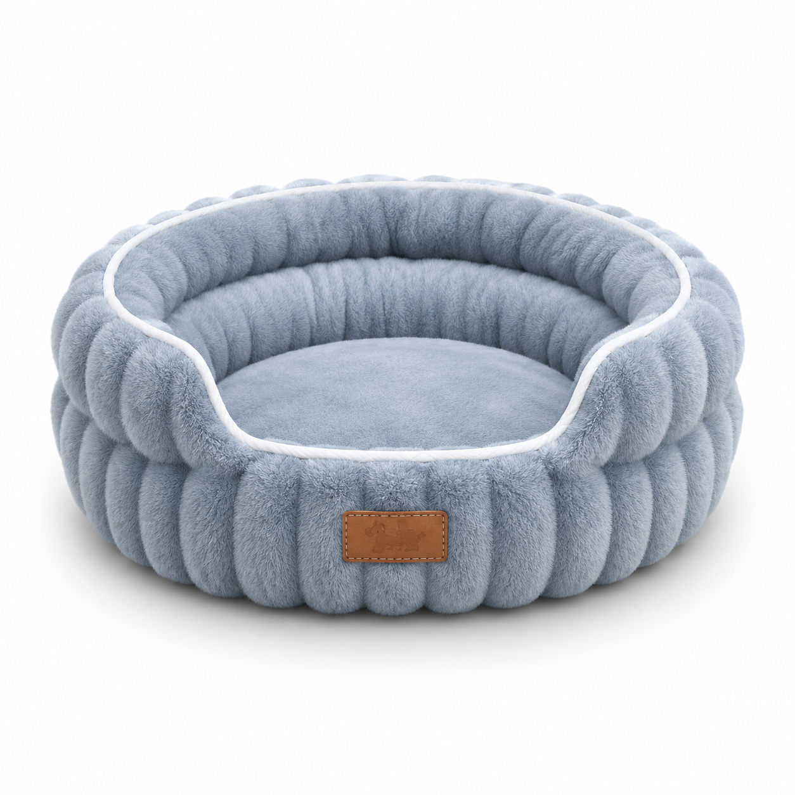
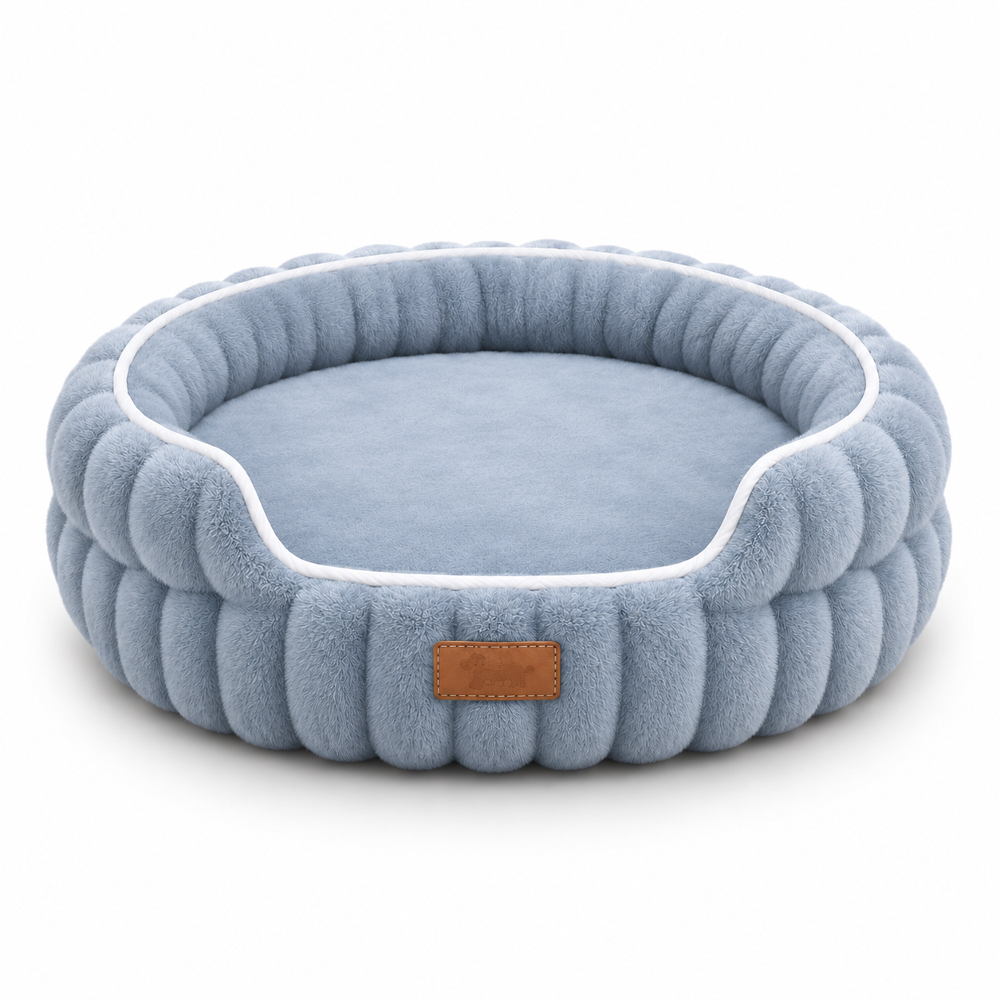
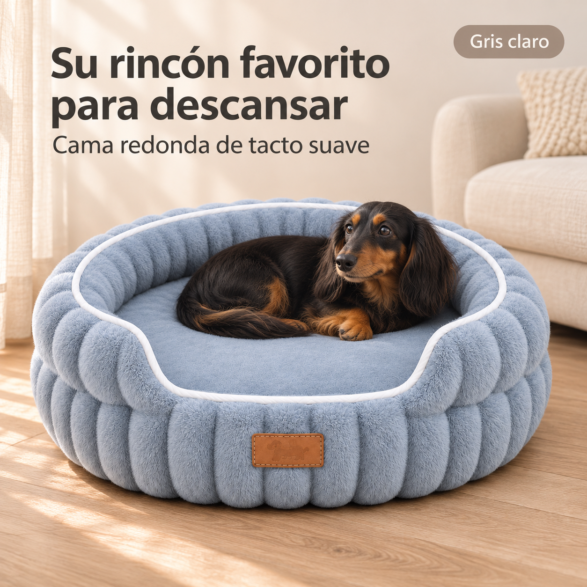
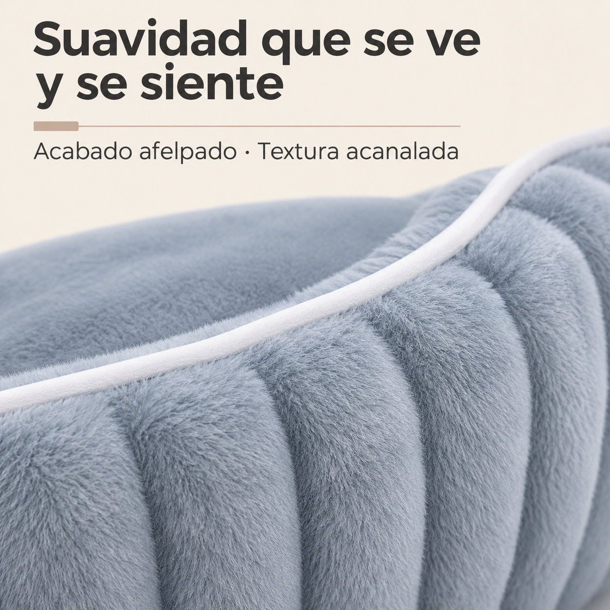
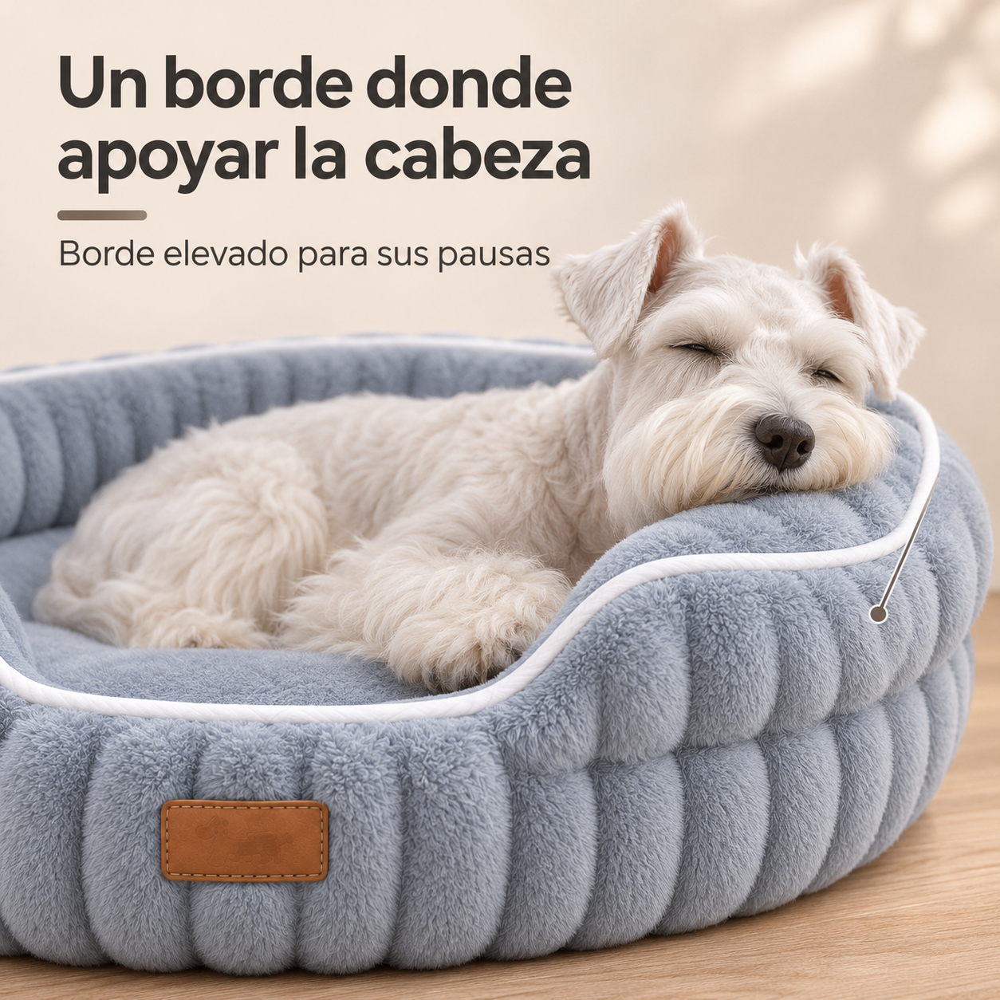
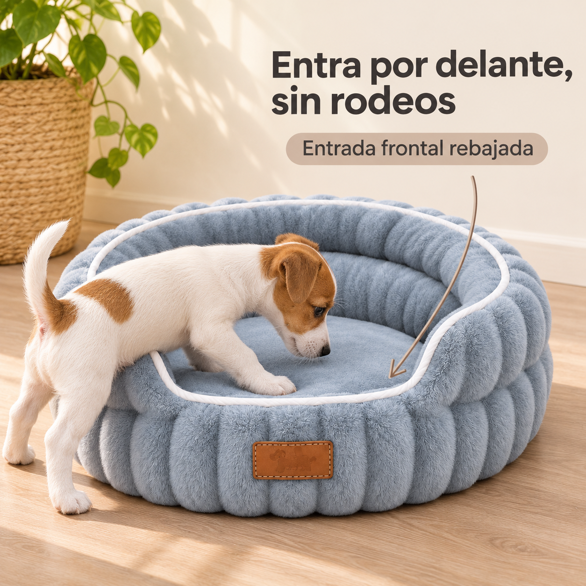
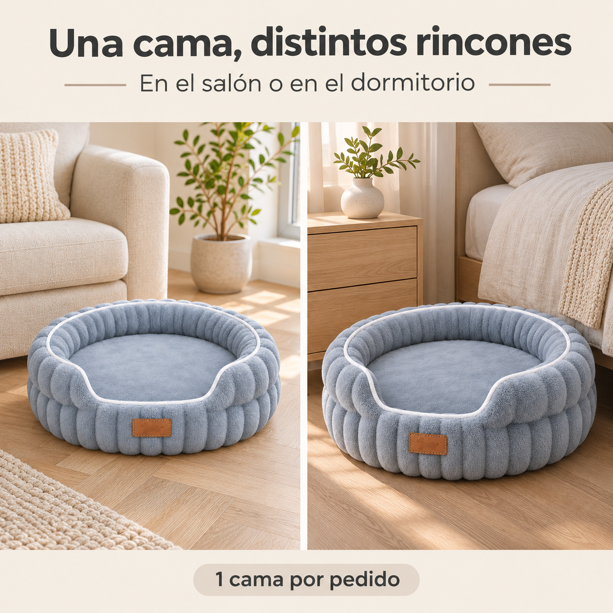
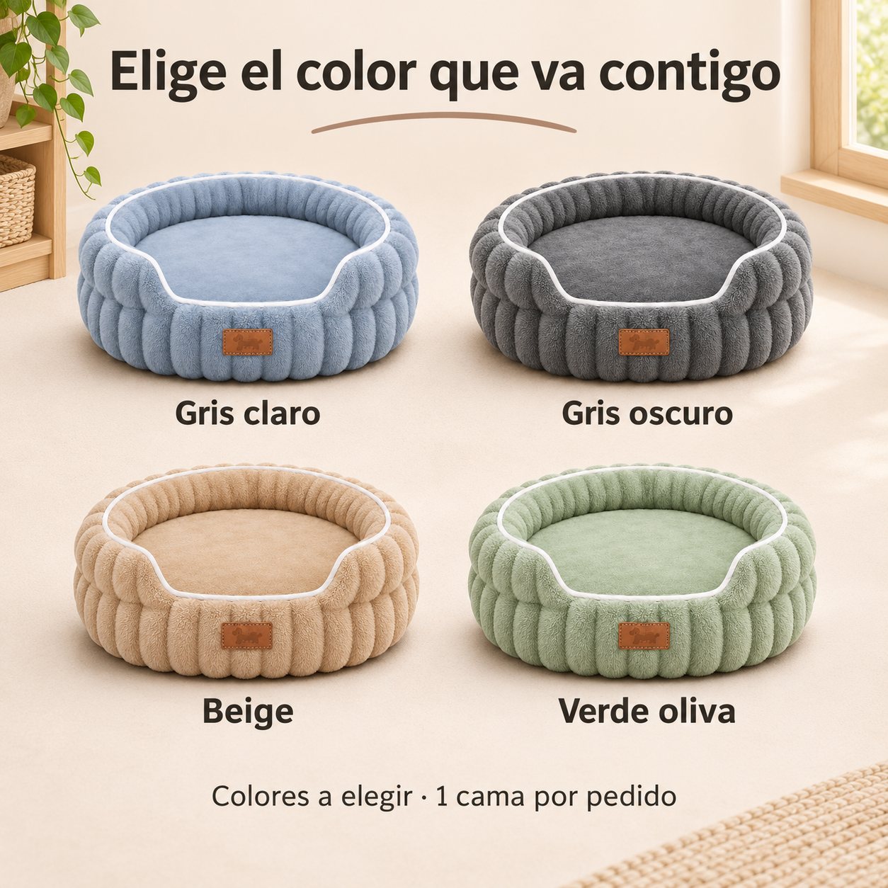
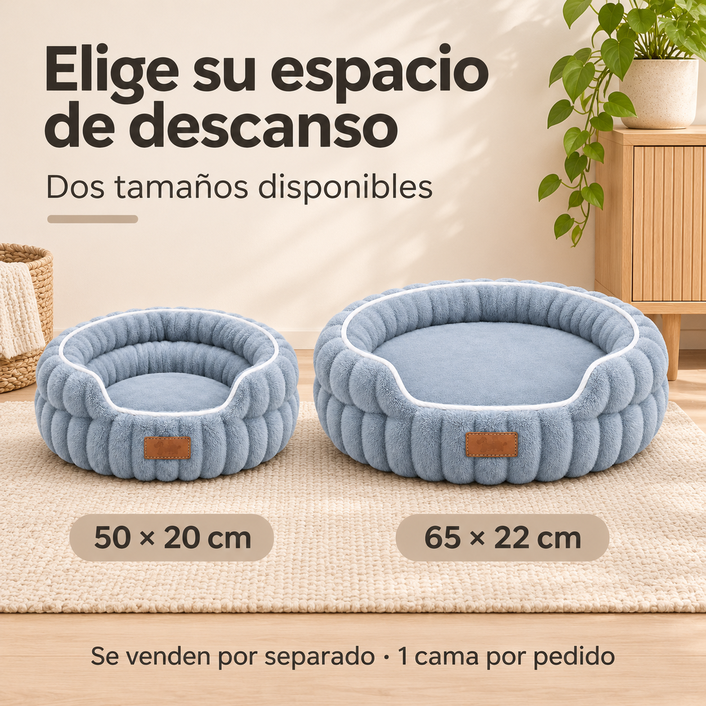

# 案例：圆形抽条绒宠物窝，供货套装拆分单卖

[首页](../../README.md) · [使用教程](../../docs/usage.md)

制作日期：2026-11-13。使用 Codex 内置生图，逐张生成、查看并保存。本页展示实际输出。

## 商品和任务

主推浅灰圆形抽条绒宠物窝，保留低开口、白色包边、棕色小标。供货图把两个尺寸嵌套叠放，实际拆成两个尺寸SKU，每单到手1个。

原始规格50×20 cm、65×22 cm，数字测量口径及内径未确认。先提取两个独立单窝，再生成1张主图和6张详情，全部1:1，包含颜色选择和多个室内场景。

公开案例未附原始供货截图。复用提示词时，需要提供自己有权使用、与任务相符的商品图。

## 两个独立单窝参考

<table>
<tr><td> 50×20 cm</td><td> 65×22 cm</td></tr>
</table>

原图隐藏区域由AI保守复原，不是实物结构核验。这两张不计入七张营销成品。

## 主图：单件商品与休息体验

**Su rincón favorito para descansar**：它喜欢的休息角。商品完整可辨，没有把两个尺寸画成两件一起出售。

## 六张独立详情

| 图片 | 买家问题与画面证据 |
|---|---|
| 绒面抽条 | 表面是什么感觉？局部展示绒面、宽抽条及包边 |
| 围边枕靠 | 围边有什么用？白色小犬枕靠动作 |
| 低口进入 | 从哪里进入？另一只小犬跨入的动作 |
| 室内位置 | 放在哪里？客厅和卧室两种摆放 |
| 颜色选择 | 有哪些颜色？四个单窝分别对应色名 |
| 规格选择 | 两规格如何选？单窝与原始规格对应，注明分别出售 |

<table>
<tr><td></td><td></td></tr>
<tr><td></td><td></td></tr>
<tr><td></td><td></td></tr>
</table>

## 配套材料

- [输入简报](brief.md)：明确单卖、到手数量、参考角色和禁改细节。
- [逐图方案](plan.md)：任务、证据、构图及西语中文对应。
- [研究记录](research.md)：8个可访问的西班牙商品页及访问边界，未核实Temu销量。
- [全部9条Prompt](prompts.json) / [独立文件](prompts/)：2张单窝参考和7张成品各自独立调用。
- [目视验收](qa.md) / [文件像素、大小与哈希](manifest.json)：全部1254×1254 PNG，单张约1.78–2.50 MiB。

## 结果和限制

案例展示了资料收集、配置纠正、提取参考、策划与实际生图的完整链路。选择图写明每单一个，三张宠物使用图采用不同狗和姿势，没有补造第三尺寸。

未进行真实CTR/CVR实验。源图清晰度有限，放大纹理、模糊小标和遮挡区域属于AI复原，不能当实拍微距或品牌细字证明。尺寸口径仍需核实，正式发布需对照实际商品与目标店铺要求。

